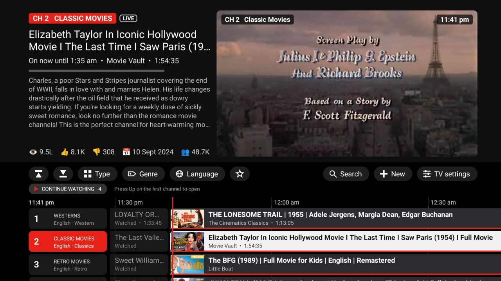
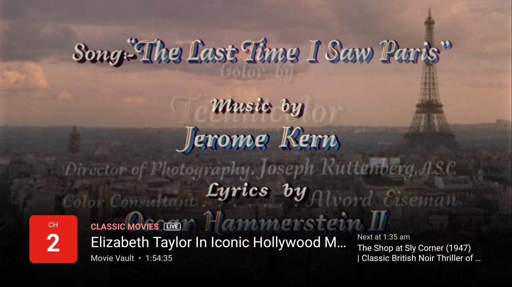

# SmartTube Plus

[SmartTube](https://github.com/yuliskov/SmartTube) with a TV mode added: YouTube as a set of TV channels with a programme guide. Everything else is SmartTube as it is.

This is a personal fork. It is not made or supported by SmartTube's author, so please don't report its problems to SmartTube.

## TV mode

Each channel is a running lineup of YouTube videos, picked by search terms, YouTube channels or playlists. Your YouTube recommendations and watch history are never used to fill them.

- **About 180 preset channels** in English and Hindi: movies, music, series, documentaries, kids, podcasts, sport, news and ambience, plus 22 live news channels that follow a network's own stream.
- **Live or Free.** A Live channel runs on the clock while the app is closed, so you join part-way through, like real TV. A Free channel waits where you left it.
- **A programme guide** with a timeline, a red line for now, and the focused channel playing in the preview.
- **Changing channel** works with CH+ / CH-, number keys, Up / Down, or the on-screen keypad for remotes without numbers. The keypad's arrows browse channels and show what's on without switching; Go switches.
- **Series channels** play playlists in episode order and remember the episode you're on.
- **Podcast channels** follow named podcasters and sort their shows by upload date, newest on the right.
- **Your own channels.** Make one from a topic or a playlist, then set its search terms, YouTube channels, length, language, upload date and skip words. Hold OK on a programme for its options, including **Why is this on?**, which shows the search it came from and which of its words the title matched.
- **Continue watching** and **Save for later** lists, a sleep timer, and a random-programme button.

## Install

On the TV, open the [Downloader](https://www.aftvnews.com/downloader/) app and enter a code:

| | Code | |
|---|---|---|
| **SmartTube Plus** | `9583142` | The release app. Rebuilt on each SmartTube release. |
| **SmartTube Plus dev** | `6905756` | Gets every change first. Installs next to the release app. |

Or download an APK from [Releases](https://github.com/IndoDev-B/SmartTube/releases). The first install asks you to allow apps from unknown sources. After that, update from Settings > About.

It runs on Android TV, Google TV and Fire TV. It does not run on Fire TV devices with Vega OS (Fire TV Stick 4K Select and newer). It installs alongside the official SmartTube.

## YouTube Data API key (optional)

TV mode works without a key. Searches then go through the same YouTube interface the app already uses, which gives a title, a creator, a rough view count and age, and usually a length.

A key lets channels know more about a video before it airs:

- **The language the uploader set**, so a Hindi film doesn't land on an English channel because its title is in English.
- **Exact length, views and upload date**, for the length, view-count and freshness rules.
- **Searching as a country** (English channels search as the US, for example), which gives different results from searching from India.
- **YouTube's most-popular chart**, which the Trending channels read.

The key is your own and stays on your TV. Google gives each key 10,000 units a day at no cost. Details for 50 videos cost 1 unit and a search costs 100, so the app limits itself to about 95 searches a day and stops for the day before the limit.

To get one:

1. Go to the [Google Cloud console](https://console.cloud.google.com/) and create a project (any name).
2. Open [YouTube Data API v3](https://console.cloud.google.com/apis/library/youtube.googleapis.com) and press **Enable**.
3. Go to **APIs & Services > Credentials**, press **Create credentials > API key**, and copy the key.
4. Recommended: edit the key and, under **API restrictions**, restrict it to YouTube Data API v3.
5. In the app, open the TV guide, then **TV settings > YouTube API key**, and paste it. The line then shows whether Google accepted it.

No billing account is needed for this.

## How the repository is set up

- **`my-features`** is the default branch and holds all the changes. Every push to it builds the dev app.
- **The release app** is built by a workflow that takes SmartTube's latest release tag and applies `my-features` on top of it. It runs daily and only builds when SmartTube has a new release, or when started by hand.
- **`master`** is a plain copy of SmartTube and is not used by either build. It is not kept up to date.
- **The preset channel list** is [`common/src/main/assets/tv_mode_dev.json`](common/src/main/assets/tv_mode_dev.json) for dev and `tv_mode_stable.json` for release. The apps download it from this repository, so channel changes reach TVs without a new build.

## Credits

All credit for SmartTube goes to [Yuriy Liskov](https://github.com/yuliskov) and its contributors. If you find it useful, [support the original project](https://github.com/yuliskov/SmartTube#donation). This fork keeps SmartTube's licence.
