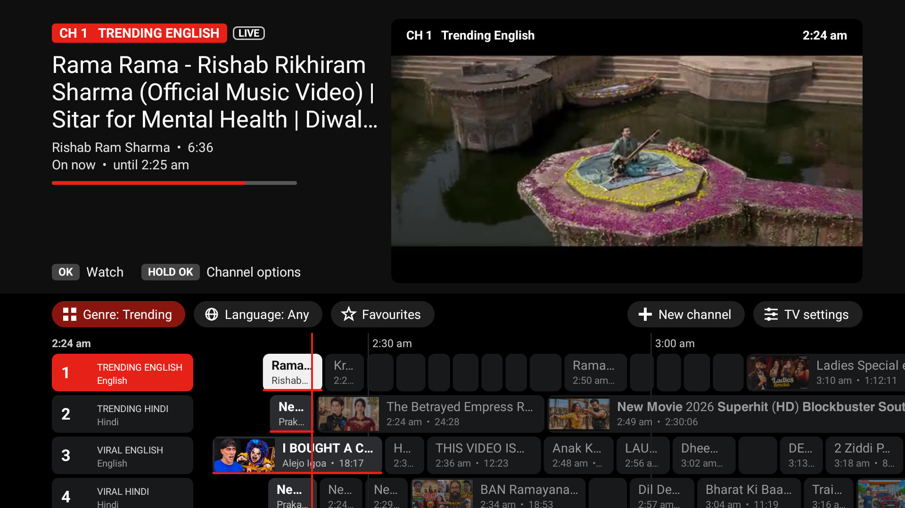

# SmartTube Plus

SmartTube Plus is [SmartTube](https://github.com/yuliskov/SmartTube) with a few extra features. SmartTube is a free, open-source YouTube client for Android TV by Yuriy Liskov. Everything SmartTube does, this app does too. It installs next to the official app, so you can keep both.

This is a personal project. It is not made or supported by the SmartTube author. Please don't report problems with this app to SmartTube.

## What it adds

**TV mode** turns YouTube into a TV with channels. It is in the dev build for now.

- **About 200 channels in 20 genres**, in English and Hindi: Movies, Songs, Documentary, Kids, Podcasts, Live streams, Ambience and more. Each channel is a lineup of YouTube videos found by search. No recommendations and no watch history are used.
- **A TV guide** on one time line, with a red line for now. The focused channel plays in a preview window.
- **Live TV or Free mode.** A Live TV channel runs on the clock, even while the app is closed. A Free mode channel waits where you left it.
- **CH+ and CH-** change channel. Number keys tune to a channel number. Up and Down can change channel too, for remotes without channel buttons.
- **Filters** for genre, language and favourites. They only hide channels, and CH+ / CH- stay within what is shown.
- **Your own channels.** Make one from a topic, then set its search terms, YouTube channels, length, upload date, order, features, language and genre. Hold OK on a channel for its options.
- **Sleep timer**, a random-video button, and a VHS-style effect while a channel loads.

**In every build:** at the end of a video the focus stays on the player controls. SmartTube moves it to the chapters.

## Install

Use the [Downloader](https://www.aftvnews.com/downloader/) app on the TV and enter a code.

| | Code | What you get |
|---|---|---|
| **SmartTube Plus** | `9583142` | SmartTube with the small fixes. Follows each SmartTube release. |
| **SmartTube Plus dev** | `6905756` | Everything above plus TV mode. Updated often, may have rough edges. |

Or download an APK from [Releases](https://github.com/IndoDev-B/SmartTube/releases). The first install asks you to allow apps from unknown sources. After that the app updates itself from Settings, About.

It works on Android TV, Google TV and Fire TV. It does not work on Fire TV devices that run Vega OS (Fire TV Stick 4K Select and newer).

## How it is built

- The `master` branch is SmartTube, untouched. The `my-features` branch holds the changes.
- Every push to `my-features` builds the dev app.
- When SmartTube publishes a release, a workflow applies the changes on top of it and publishes SmartTube Plus.
- TV mode's preset channels are in `common/src/main/assets/tv_mode_dev.json`. The app downloads that file, so the channel list can change without a new build.

## Credits and licence

All credit for SmartTube goes to [Yuriy Liskov](https://github.com/yuliskov) and its contributors. If you find the app useful, consider [supporting the original project](https://github.com/yuliskov/SmartTube#donation). This fork keeps SmartTube's licence.
